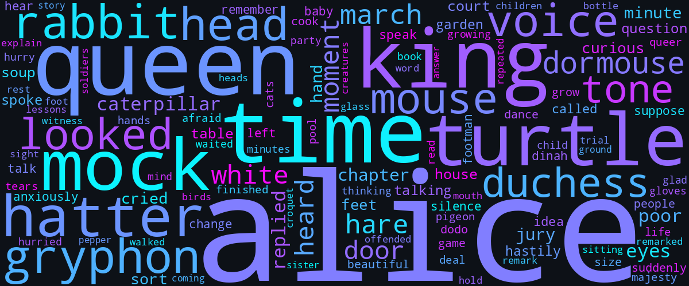
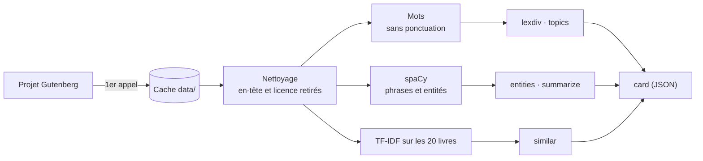

<div align="center">

# 🐛 Bookworm — Alice's Adventures in NLP

**Analyse de livres classiques en ligne de commande : vocabulaire, thèmes, personnages, résumé et recommandations.**

[](https://github.com/Lois5959/ALICE-IN-WONDERLAND/actions/workflows/ci.yml)




<sub>Les mots les plus fréquents d'<i>Alice's Adventures in Wonderland</i>, sans les mots vides.</sub>

</div>

---

## 🎯 En bref

**Bookworm** télécharge des livres du [Projet Gutenberg](https://www.gutenberg.org/) et les analyse avec des
techniques de **traitement du langage naturel (NLP)**. Une commande = une analyse, et `--card` les réunit toutes
dans une fiche JSON.

| Commande | Ce qu'elle fait | Technique |
|---|---|---|
| `--lexdiv ID` | Richesse du vocabulaire | Comptage de mots, type/token ratio |
| `--topics ID` | Les 10 mots qui résument le livre | Fréquences sans mots vides |
| `--entities ID` | Les personnages principaux | Reconnaissance d'entités nommées (spaCy) |
| `--summarize ID` | Un résumé en 3 phrases | Résumé extractif par score de phrases |
| `--similar ID` | Les 5 livres les plus proches | TF-IDF + similarité cosinus |
| `--card ID` | La fiche complète en JSON | Tout ce qui précède |
| `--list` | Les 20 livres disponibles | |

---

## ⚡ Démarrage rapide

```bash
git clone https://github.com/Lois5959/ALICE-IN-WONDERLAND.git
cd ALICE-IN-WONDERLAND
python -m venv .venv && source .venv/bin/activate
pip install -r requirements.txt
python -m spacy download en_core_web_sm

python bookworm.py --card 11
```

Les 20 livres sont déjà dans `data/` : tout fonctionne **hors ligne**. Un livre absent du dossier
est téléchargé une fois puis gardé en cache.

---

## 🖥️ Exemples

<table>
<tr>
<td width="50%" valign="top">

**Diversité lexicale** d'*Alice*

```text
$ python bookworm.py --lexdiv 11
{'tok': 27429, 'typ': 2578, 'hap': 1109,
 'ttr': 0.094, 'mwl': 3.94, 'mwf': 10.64}
```

27 429 mots, dont 2 578 différents ;
1 109 n'apparaissent qu'une seule fois.

</td>
<td width="50%" valign="top">

**Livres similaires** à *Sherlock Holmes*

```text
$ python bookworm.py --similar 1661
- The Memoirs of Sherlock Holmes
- The Return of Sherlock Holmes
- Dracula
- Treasure Island
- The Time Machine
```

Les deux autres recueils de Holmes arrivent en tête.

</td>
</tr>
<tr>
<td valign="top">

**Thèmes**

```text
$ python bookworm.py --topics 11
['alice', 'queen', 'time', 'king', 'turtle',
 'mock', 'hatter', 'gryphon', 'rabbit', 'head']
```

</td>
<td valign="top">

**Personnages**

```text
$ python bookworm.py --entities 1661
- Holmes
- Majesty
- Irene Adler
- Watson
```

</td>
</tr>
</table>

<details>
<summary><b>📇 Voir une fiche complète (<code>--card 11</code>)</b></summary>

```json
{
    "info": {
        "id": "11",
        "title": "Alice's Adventures in Wonderland",
        "authors": "Lewis Carroll",
        "bookshelves": "Children",
        "cover": "https://www.gutenberg.org/cache/epub/11/pg11.cover.medium.jpg"
    },
    "lexdiv": { "tok": 27429, "typ": 2578, "hap": 1109, "ttr": 0.094, "mwl": 3.94, "mwf": 10.64 },
    "topics": {
        "1": ["alice", "queen", "time", "king", "turtle", "mock", "hatter", "gryphon", "rabbit", "head"],
        "2": ["voice", "looked", "mouse", "duchess", "tone", "dormouse", "march", "moment", "hare", "white"],
        "3": ["..."],
        "4": ["..."]
    },
    "entities": { "characters": ["Alice", "..."], "locations": ["..."] },
    "summary": "The Mouse did not answer, so Alice went on eagerly: ...",
    "similar": ["Through the Looking-Glass", "..."]
}
```

</details>

---

## 🧠 Comment ça marche



- **Résumé extractif** : chaque phrase reçoit un score égal à la somme des fréquences de ses mots importants.
  Les 3 meilleures sont gardées, dans l'ordre du livre.
- **Similarité** : chaque livre devient un vecteur TF-IDF (les mots fréquents dans ce livre mais rares ailleurs
  pèsent plus lourd), puis on compare les vecteurs avec la similarité cosinus.

## 📚 Bibliothèque

<details>
<summary>20 livres en 4 rayons</summary>

| Rayon | Livres (id Gutenberg) |
|---|---|
| Children | Alice (11), Through the Looking-Glass (12), Peter Pan (16), The Wonderful Wizard of Oz (55), The Secret Garden (113), Treasure Island (120), The Jungle Book (236) |
| Crime | The Adventures (1661), Memoirs (834) et Return (108) of Sherlock Holmes, The Mysterious Affair at Styles (863), Poirot Investigates (61262), The Murder of Roger Ackroyd (69087), The Big Four (70114) |
| Science Fiction | The Time Machine (35), The War of the Worlds (36), Frankenstein (84), The Island of Doctor Moreau (159), Twenty Thousand Leagues under the Sea (164) |
| Gothic | Dracula (345) |

</details>

## 🧪 Tests

```bash
pip install -r requirements-dev.txt
pytest -q
```

Nettoyage du texte Gutenberg, découpage en mots, mesures lexicales, thèmes, lecture de l'auteur et refus d'un
id inconnu **sans** téléchargement. La CI GitHub Actions lance `flake8` et `pytest` à chaque push.

## 📁 Structure

```
.
├── bookworm.py         # ligne de commande et analyses
├── data/               # livres en cache (domaine public, Projet Gutenberg)
├── docs/               # nuages de mots
├── tests/              # pytest
├── requirements.txt
└── .github/workflows/ci.yml
```

---

<div align="center">

Projet du module **B-AIA-200** · Bachelor Epitech Lille · par **Loïs-Elie Ekollo**

</div>
